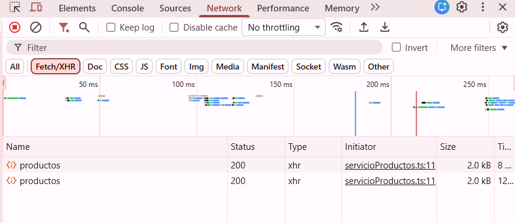
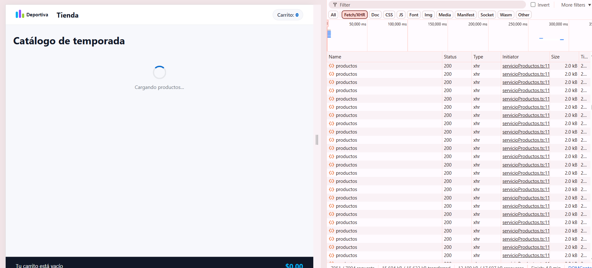
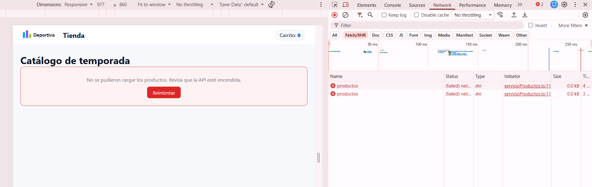
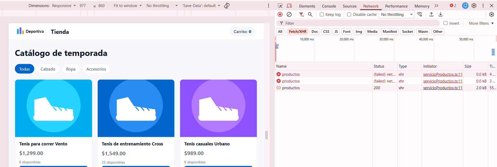
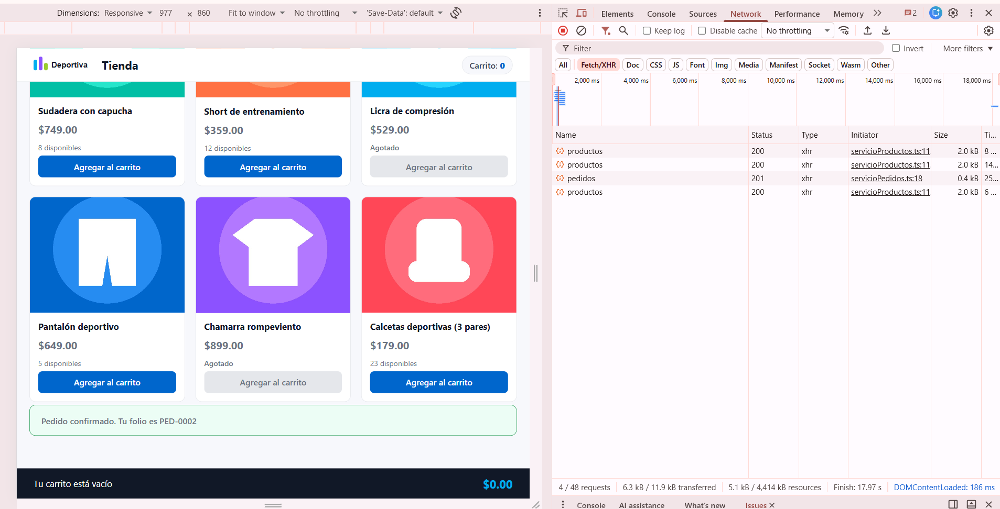
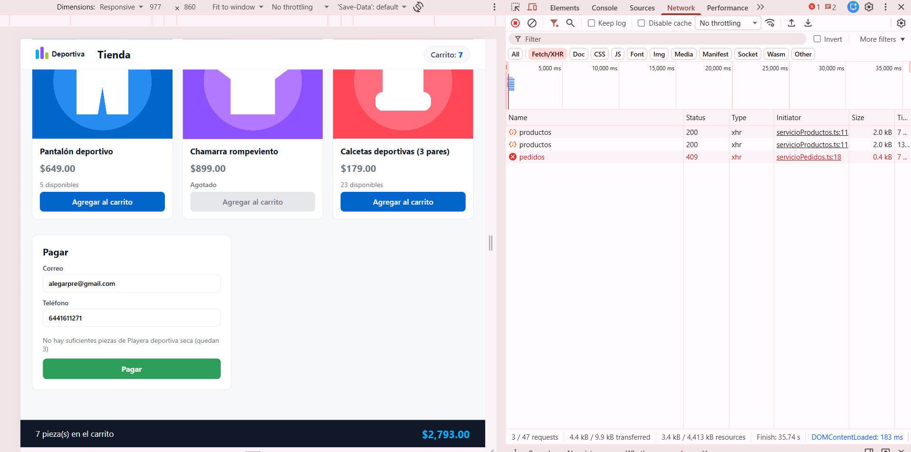

# Práctica 13 – La tienda: composición, eventos y estado

## Ejercicio 1: el marco de la página

### ¿Por qué el Layout no necesita saber que es una tienda?

Porque el Layout solo acomoda tres lugares: uno arriba, uno en medio y uno abajo. Lo que va en cada lugar se lo manda el que lo usa (en mi caso `App`): el encabezado, el pie y lo que va entre sus etiquetas (`children`). El Layout no lee ni usa nada de productos o carrito, nada más los pone en su lugar. 

## Ejercicio 2: el catálogo

### ¿Qué pasa si escribes onClick={onAgregar(producto)} sin la flecha?

Lo probé quitándole la flecha al botón. Me salió esto

- En el editor, la línea se subrayó en rojo con este error: `Type 'void' is not assignable to type 'MouseEventHandler<HTMLButtonElement> | undefined'`. Más o menos significa que `onClick` quería una función y yo le di otra cosa.
- La página sí siguió cargando, pero al recargar, sin tocar nada, la consola ya traía los nombres de los productos escritos. Salieron los 12, cada uno dos veces. Creo que se repiten porque React en modo desarrollo pinta dos veces.
- Cuando le daba clic a "Agregar al carrito" no pasaba nada, no se imprimía nada nuevo.

## Ejercicio 3: filtrar y agregar al carrito

### ¿Por qué con carrito.push(...) el contador no se mueve y no sale ningún error?

Lo probé cambiando `setCarrito([...carrito, producto])` por `carrito.push(producto)`. Lo que vi:

- Le daba clic a "Agregar al carrito" y no pasaba nada: el contador y el total se quedaban igual.
- No salió ningún error, ni en la consola ni en el editor.
- Cuando volví a poner `setCarrito([...carrito, producto])`, de pronto aparecieron en el carrito todos los productos a los que les di clic mientras tenía el `push`.

Lo que entiendo esq el `push` sí agrega el producto al arreglo, por eso después aparecieron, pero no avisa a React de que algo cambió. React solo vuelve a pintar la página cuando se usa `setCarrito`. Creo que los productos aparecieron al volver a poner la línea buena porque en ese momento la página se pintó otra vez y ya vio el arreglo con todo lo que le había metido.

# Práctica 14 – La tienda contra su API

## Ejercicio 1: traer los productos de la API

### ¿Por qué en la pestaña Red salen dos peticiones al cargar?

Abrí la pestaña Red con el filtro Fetch/XHR, recargué la página y salieron dos peticiones a `productos`, las dos con estado 200.

Creo que es por el `StrictMode` que está en `main.tsx`: cuando la página está en modo desarrollo, React corre los efectos dos veces al arrancar para ver si algo está mal hecho. Eso no lo comprobé quitando el `StrictMode`, pero sí noté que cuando le di "Reintentar" salió una sola petición nueva y no dos, y ahí no se está arrancando la página otra vez.

### ¿Qué pasa si quitas el arreglo de dependencias del efecto? Muéstralo en la pestaña Red

Le quité el `[intento]` del final del `useEffect` y recargué con la pestaña Red abierta. Lo que vi:

- Se llenó de peticiones a `productos`, todas con estado 200, una tras otra sin parar. Cuando tomé la captura ya iban más de 7,000 (`7051 / 7094 requests`) y habían pasado casi 5 minutos.
- En la página primero salía «Cargando productos…» y luego los productos, pero la lista de peticiones seguía creciendo.

Lo que entiendo: sin el arreglo, el efecto se vuelve a ejecutar cada vez que la página se pinta. Y dentro del efecto cambio el estado (`setCargando`, `setProductos`), lo que hace que la página se pinte otra vez, y así se repite sin fin. Con el arreglo `[intento]` el efecto solo corre al principio y cuando le doy "Reintentar".

### Cuando la API está apagada y el reintento

También probé apagar la API y recargar: sale el cuadro rojo con el mensaje y el botón «Reintentar», y en la pestaña Red las dos peticiones salen en rojo (`failed`).

Después volví a encender la API y le di «Reintentar»: cargó el catálogo sin recargar la página. En la pestaña Red se ve la petición nueva con estado 200 después de las dos que habían fallado.

## Ejercicio 2: el pago simulado

Con un producto en el carrito sale el formulario «Pagar». Si pongo un correo con `@` y un teléfono de 10 dígitos, se manda el pedido y sale el folio. El carrito se vacía y la tienda vuelve a pedir los productos (en la pestaña Red se ve el `pedidos` con 201 y después otro `productos`), y las existencias bajan.

Si pido más piezas de las que hay (por ejemplo 4 de la Playera deportiva seca, que solo tiene 3), la API contesta 409 y su mensaje sale en el formulario. El carrito se queda como estaba.

### ¿Qué hace e.preventDefault() y qué pasa si lo quitas?

Lo probé quitando la línea `e.preventDefault()` y mandando el formulario con un correo y un teléfono válidos. Lo que vi:

- La página se recargó sola.
- El carrito se vació.
- No salió ningún folio.
- Yo pensé que el pedido no se había hecho, pero revisé la API y la existencia de «Tenis casuales Urbano» había bajado de 5 a 3, o sea que el pedido sí llegó y sí se descontó, solo que yo no vi el folio.

Lo que entiendo: los formularios del navegador, cuando les das a enviar, recargan la página por su cuenta. `e.preventDefault()` le dice al navegador que no haga eso y que deje que el código de React se encargue. Sin esa línea, la página se recarga y React pierde todo lo que tenía guardado en el estado (el carrito y el folio), por eso se vació y no salió nada. Creo que el pedido sí alcanzó a salir antes de que se recargara.
